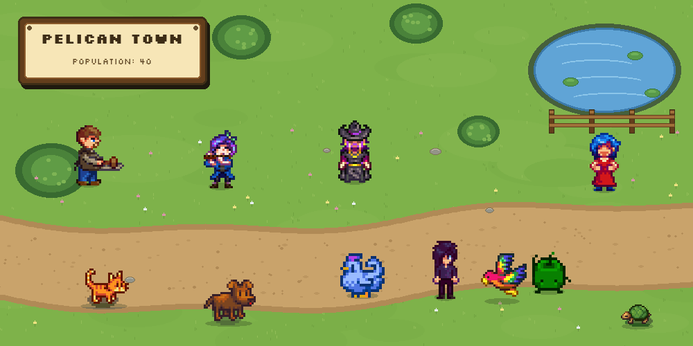
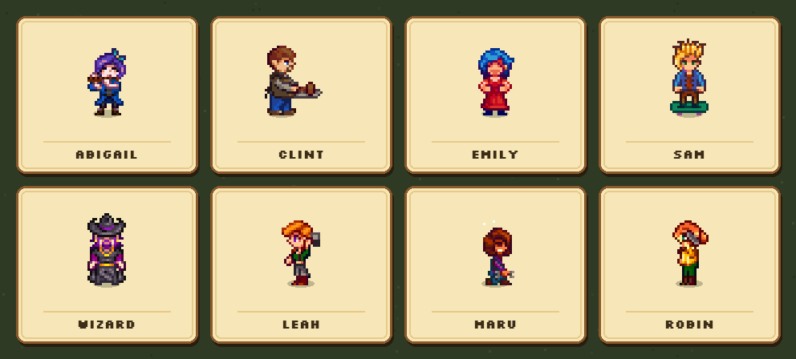
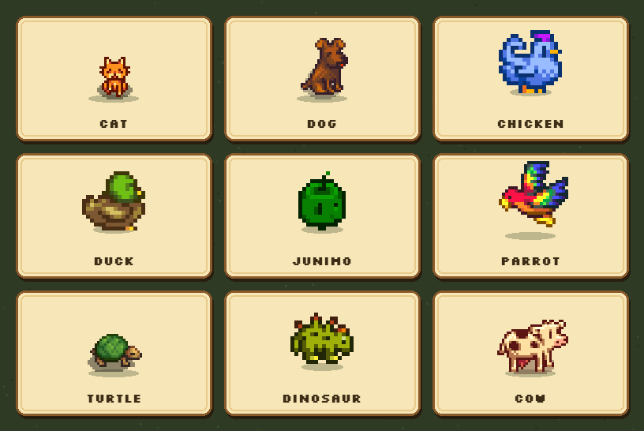

# 🐾 Stardew Valley Pals

**English** · [简体中文](README.zh-CN.md)

**Little neighbours for your Obsidian vault.**

Adopt pixel pets, invite 40 Stardew Valley villagers into your workspace, and let them wander, work, chat — and occasionally read over your shoulder.

**40 villagers · 9 pet species · 40 colour options · panel or overlay**

## Why you'll love it

- 🐾 **A workspace that feels alive.** Cats, dogs, chickens, junimos and more wander, nap and ask for attention while you write.
- 🧑‍🌾 **40 villagers, each one themselves.** Abigail plays her flute, Clint hammers at his anvil, Emily dances. Every animation is hand-picked from the original game sheets.
- 💬 **They notice your notes.** With an AI provider connected, right-click (or long-press) a villager for an in-character comment on whatever you're writing.
- 🧠 **They remember you.** Villagers hold on to a few core memories — your novel, your exams, your favourite tea — and bring them up later.
- 🪟 **Panel or overlay.** Keep everyone in a dockable side panel, or let them roam the whole Obsidian window — on desktop, tablet, and phone.

## Meet the villagers

All 40 characters walk, idle and react in their own style, and many have signature activities: Clint at the anvil, Abigail's flute, Emily's dancing, Sam on his skateboard, the Wizard's cauldron, Leah sculpting, Maru welding, Robin hammering — and plenty more.

Turn on **Scheduled visits** and Pelican Town comes to you. Everyone keeps their own daily routine, the roster rotates each day, and you choose how many villagers can be in town at once (1–6). Pets are unaffected.

## Pets

Nine species — cats, dogs, chickens, cows, ducks, dinosaurs, parrots, junimos and turtles — with **40 colour combinations**. Name them whatever you like and adopt as many as you want.

They wander, sit, sleep, and never say a word. Click or tap one for a heart.

## They read over your shoulder

Connect an OpenAI-compatible AI provider and villagers can:

- **comment on your current note** when you right-click them on desktop or long-press them on mobile;
- **speak up on their own** at a natural, adjustable rate;
- **remember durable facts about you** and bring them up in later conversations.

Each villager has their own personality and voice: Sebastian is dry and nocturnal, Evelyn fusses over you, Shane is having a day. No API key? Everything else still works — only the dialogue needs AI.

## They talk to each other

Drop one villager onto another and they'll walk to a spot, turn to face each other, and chat — nearby animals come over to watch. Prefer to be surprised? Leave **Villager conversations** on and they'll start chats on their own while you work.

*Both demos were recorded in Obsidian. Dialogue is sample text; the walking, drag-and-drop, bubbles and reactions are the real plugin.*

## Two ways to hang out

- **Panel mode** — a resizable pet panel you can dock anywhere in your workspace. On mobile it opens in its own tab, with the usual back button.
- **Overlay mode** — a transparent layer over the entire Obsidian window, so pets stay with you as you move between notes.
- **Interact** — drag anyone to a new spot, click or tap for a heart, or right-click / long-press a villager to talk.

### On mobile

The plugin works on Obsidian for **Android and iOS** as well as desktop. New mobile installs start in overlay mode, so pets float above the note you are writing; switch to panel mode in settings if you would rather give them their own tab.

- **Tap** a pet for a heart.
- **Drag** to move it — drop one villager onto another to start a conversation.
- **Long-press** a villager to hear what they think of your current note.

The ribbon icon or the **Toggle pet view** command shows and hides them.

## 🚀 Get started

1. **Install.** Go to **Settings → Community Plugins → Browse**, search for **Stardew Valley Pals**, then **Install → Enable**.
2. **Adopt a companion.** Open the pet panel with the 🐱 ribbon icon, then run **Add a pet** from the command palette and pick a pet or villager. Pets can be named.
3. **Make it yours.** Open **Settings → Stardew Valley Pals** to switch between panel and overlay, change size and speed, or turn on scheduled visits.

> **Desktop, tablet, and phone.** Requires Obsidian 1.13 or newer.

<strong>Install with BRAT or manually</strong>

**BRAT**

1. Install the **BRAT** plugin from the Community Plugins store.
2. Open **Settings → BRAT → Add Beta Plugin**.
3. Enter `https://github.com/miaowuduck/stardew-valley-pals`.
4. Enable **Stardew Valley Pals** in **Settings → Community Plugins**.

**Manual**

1. Download the latest release from the [Releases page](https://github.com/miaowuduck/stardew-valley-pals/releases).
2. Extract the folder into `.obsidian/plugins/` in your vault.
3. Reload Obsidian and enable the plugin.

## 🤖 Optional: give them a voice

The plugin ships with a guided **DeepSeek** setup, so you don't need to know what an API key is before you start.

1. Open **Settings → Stardew Valley Pals → AI configuration** and click **Set up DeepSeek** (or run **Set up DeepSeek AI** from the command palette).
2. **Sign in** at [platform.deepseek.com](https://platform.deepseek.com/sign_in) with your phone number or WeChat. First login creates your account automatically.
3. **Top up** a small amount with Alipay or WeChat Pay. API credit is separate from DeepSeek's free web chat.
4. **Create an API key** on the API keys page and copy the `sk-...` value. It is shown only once.
5. Paste the key into the wizard and click **Save & test**. The plugin stores it in Obsidian's secret storage and verifies the connection for you.

The default provider is DeepSeek with `https://api.deepseek.com/v1` and the model `deepseek-flash`. OpenAI, Google Gemini, and other OpenAI-compatible providers still work through the advanced fields under **AI configuration**. **AI dialogue in Chinese** is separate from the interface language.

### Local / self-hosted APIs (Ollama, LM Studio, llama.cpp…)

The plugin speaks the OpenAI chat-completions protocol, so any local server that exposes an OpenAI-compatible endpoint works:

| Server | Endpoint to enter | Model |
|---|---|---|
| Ollama | `http://127.0.0.1:11434/v1` | the name from `ollama list`, e.g. `qwen2.5:7b` |
| LM Studio | `http://127.0.0.1:1234/v1` | the model shown in the LM Studio server tab |
| llama.cpp (`llama-server`) | `http://127.0.0.1:8080/v1` | the filename/model alias it reports |
| vLLM | `http://127.0.0.1:8000/v1` | the served model name |

Under **Settings → AI configuration**:

- **API endpoint** — the *base* URL ending in `/v1`, **not** the full `.../chat/completions` address. A bare `http://127.0.0.1:11434` is normalized to `/v1` automatically.
- **Model** — the exact ID the server expects. This is the most common mistake; copy it from the server's model list.
- **API key secret** — local servers usually don't authenticate, so you can leave it empty. If your proxy requires one, create a secret as usual.

Click **Test connection**. If it fails, a dialog shows the effective URL, model, HTTP status, and the server's response. The same details are written to the developer console (`Ctrl+Shift+I` → Console, prefixed with `[Stardew Valley Pals]`), which is what to attach to a bug report.

**From a phone or tablet**, `127.0.0.1` means the device itself. Use your computer's LAN IP instead — for example `http://192.168.1.20:11434/v1` — and make the server listen on `0.0.0.0`. Both devices must be on the same Wi-Fi. On iOS, allow Local Network access when prompted. HTTPS is more reliable than plain `http://` because some mobile systems block cleartext traffic.

## ⚙️ Settings at a glance

| Setting | What it does |
|---|---|
| **Interface language** | Follow Obsidian automatically, or force English / 简体中文 |
| **Overlay mode** | Roam the whole window instead of sitting in a side panel |
| **Pet size / Movement speed** | Scale from 0.5× to 3× and set how briskly pets wander |
| **My pets** | See everyone you've adopted and remove any of them |
| **Scheduled visits / Max visitors** | Let villagers arrive on their daily routines, up to six at a time |
| **NPC speech / Villager conversations** | Turn AI dialogue and villager-to-villager chats on or off |
| **Core memories** | Let villagers remember durable facts about you, or clear everything they've stored |
| **Automatic rants** | Messages per hour, conversation frequency, and whether to stay quiet in the background |
| **AI configuration** | DeepSeek setup wizard, plus advanced secret, endpoint, model, dialogue language, and connection test |

## ⌨️ Commands

| Command | What it does |
|---|---|
| **Add a pet** | Choose a pet or villager to bring in |
| **Remove a specific pet** | Pick one companion to remove |
| **Remove all pets** | Clear the whole town at once |
| **Set up DeepSeek AI** | Open the beginner-friendly API setup wizard |

## 🙏 Credits

- [stardew-pet-farm](https://github.com/PROF0UND/stardew-pet-farm) — the original Stardew pet concept and sprites
- [obsidian-pets](https://github.com/hiden2000/obsidian-pets) — the original Obsidian plugin
- [StardewValley-Assets](https://github.com/Huu-Yuu/StardewValley-Assets) by Huu-Yuu — extracted game art
- [vscode-pets](https://marketplace.visualstudio.com/items?itemName=tonybaloney.vscode-pets) — the original "pets in your editor" idea

All Stardew Valley art belongs to ConcernedApe. This is a fan project, not affiliated with or endorsed by ConcernedApe or Obsidian.

## 📄 License

MIT — see [LICENSE](LICENSE).

---

*Made with ❤️ for Stardew Valley fans and Obsidian users alike.*
