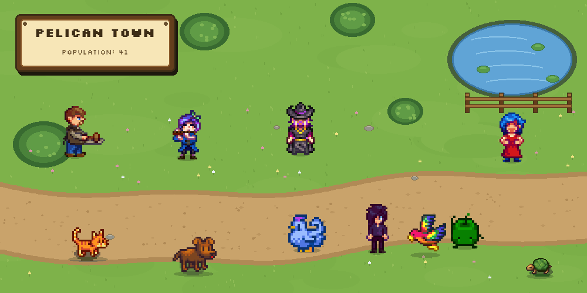
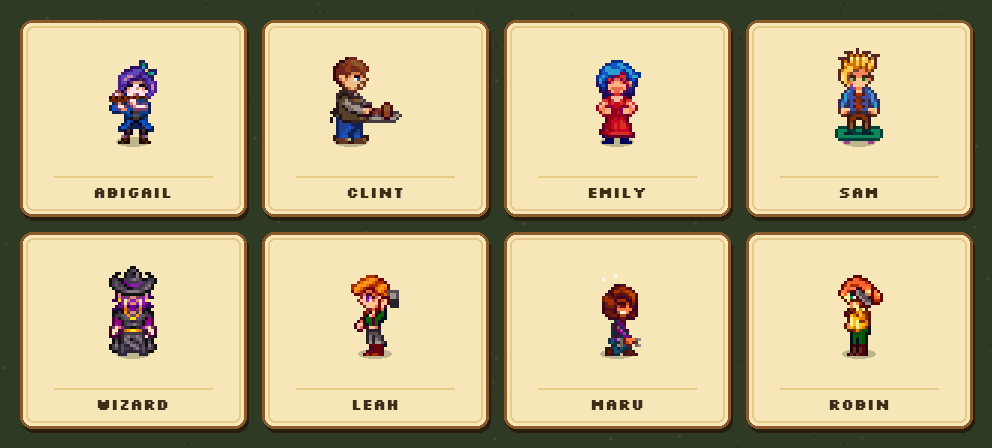
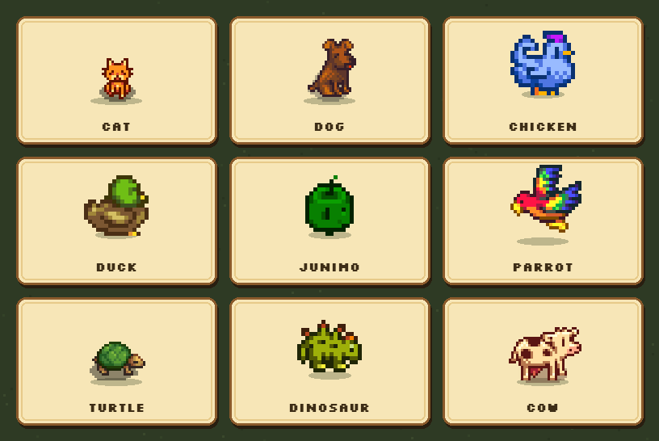

# 🐾 Stardew Valley Pals

[English](README.md) · **简体中文**

**给 Obsidian 仓库找几个小镇邻居。**

领养像素宠物，把 41 位《星露谷物语》村民请进你的工作区，让他们四处散步、干活、聊天——偶尔还会偷看你的笔记。

**41 位村民 · 9 种宠物 · 40 种配色 · 面板 / 悬浮两种模式**

## 为什么你会喜欢

- 🐾 **一个会呼吸的工作区。** 猫、狗、鸡、祝尼魔……在你写东西时四处溜达、打盹、讨关注。
- 🧑‍🌾 **41 位村民，各有各的样子。** Abigail 吹长笛，Clint 在铁砧前打铁，Emily 跳舞。每个动画都从原版游戏素材中逐帧挑选。
- 💬 **他们会注意到你的笔记。** 接入 AI 后，右键点击村民，他们会针对你正在写的内容说一句符合角色的话。
- 🧠 **他们会记住你。** 村民会记住一些关于你的长期信息——你的小说、考试、喜欢的茶——并在之后的对话里提起。
- 🪟 **面板或悬浮。** 把大家放进可停靠的侧边面板，或者让他们在整个 Obsidian 窗口里自由活动。

## 认识村民

41 位角色都有自己的走路、待机和反应动作，许多还有招牌活动：Clint 打铁、Abigail 吹笛、Emily 跳舞、Sam 玩滑板、法师搅动坩埚、Leah 雕刻、Maru 焊接、Robin 锤锤打打——还有更多。

开启 **Scheduled visits（定时来访）** 后，鹈鹕镇会主动来找你。每个人都有自己的日常作息，名单每天轮换，你还能选择同时最多有几位村民在镇上（1–6 位）。宠物不受影响。

## 宠物

9 种宠物——猫、狗、鸡、牛、鸭、恐龙、鹦鹉、祝尼魔和乌龟——共有 **40 种配色**。想取什么名字都可以，想养几只就养几只。

它们会散步、坐下、睡觉，但从不说话。点一下就能看到爱心。

## 他们会偷看你的笔记

接入任意 OpenAI 兼容的 AI 服务后，村民可以：

- 在你**右键点击**他们时，评论你当前打开的笔记；
- 以可调节的自然频率**主动开口**；
- 在之后的对话中**记住关于你的长期信息**。

每位村民都有自己的性格和说话方式：Sebastian 冷淡又夜猫子，Evelyn 总像长辈一样嘘寒问暖，Shane 则总是“今天不太行”。没有 API key？其他功能照常可用——只有对话需要 AI。

## 村民之间也会聊天

把一位村民拖到另一位身上，他们会走到一起、面对面聊上几句，附近的小动物还会围过来看。想保留一点惊喜？开启 **Villager conversations（村民对话）**，他们在你工作时也会自己聊起来。

*两段演示均录制自真实 Obsidian 界面。对话为示例文本；走路、拖拽、气泡和围观反应都来自插件本身。*

## 两种陪伴方式

- **Panel mode（面板模式）** — 可调整大小、可停靠在任意位置的宠物面板。
- **Overlay mode（悬浮模式）** — 透明覆盖整个 Obsidian 窗口，切换笔记时宠物依然陪着你。
- **互动** — 拖动换个位置，点一下看爱心，右键村民聊天。

## 🚀 快速开始

1. **安装。** 打开 **设置 → 第三方插件 → 浏览**，搜索 **Stardew Valley Pals**，然后 **安装 → 启用**。
2. **领养一位伙伴。** 点击左侧功能区的 🐱 图标打开宠物面板，然后在命令面板运行 **Add a pet**，选择宠物或村民。宠物可以自定义名字。
3. **调整成你喜欢的样子。** 打开 **设置 → Stardew Valley Pals**，切换面板/悬浮模式、调整大小和速度，或开启定时来访。

> **仅支持桌面端。** 需要 Obsidian 1.13 或更高版本。

<strong>使用 BRAT 或手动安装</strong>

**BRAT**

1. 从第三方插件商店安装 **BRAT**。
2. 打开 **设置 → BRAT → Add Beta Plugin**。
3. 输入 `https://github.com/miaowuduck/stardew-valley-pals`。
4. 在 **设置 → 第三方插件** 中启用 **Stardew Valley Pals**。

**手动安装**

1. 从 [Releases 页面](https://github.com/miaowuduck/stardew-valley-pals/releases)下载最新版本。
2. 解压到仓库的 `.obsidian/plugins/` 目录。
3. 重新加载 Obsidian 并启用插件。

## 🤖 可选：让村民开口说话

1. 从 **OpenAI**、**Google Gemini**、**DeepSeek** 或任意 OpenAI 兼容服务获取 API key。
2. 在 Obsidian 中打开 **设置 → Stardew Valley Pals → AI configuration**。
3. 在 **API key secret** 中选择保存了 key 的 Obsidian secret（没有的话先在 Obsidian 的密钥管理器中创建一个），设置服务商的 **API endpoint** 和 **model**，然后点击 **Test connection**。
4. 保持 **NPC speech** 开启，右键村民打个招呼。

默认 endpoint 是 `https://api.openai.com/v1`，默认模型是 `gpt-5-mini`。所有 AI 交互都可以切换为中文输出（**Chinese language**）。

## ⚙️ 设置速览

| 设置 | 作用 |
|---|---|
| **Overlay mode（悬浮模式）** | 让宠物在整个窗口活动，而不是待在侧边面板 |
| **Pet size / Movement speed（宠物大小 / 移动速度）** | 0.5× 到 3× 缩放，并调整宠物闲逛的速度 |
| **My pets（我的宠物）** | 查看已领养的伙伴，移除其中任意一位 |
| **Scheduled visits / Max visitors（定时来访 / 最大访客数）** | 让村民按日常作息来访，最多同时 6 位 |
| **NPC speech / Villager conversations（村民发言 / 村民对话）** | 开关 AI 对话和村民之间的聊天 |
| **Core memories（核心记忆）** | 查看每位村民记住了什么，或全部清除 |
| **Automatic rants（自动发言）** | 每小时消息数、对话频率，以及后台时是否保持安静 |
| **AI configuration（AI 配置）** | Secret、endpoint、模型、语言和连接测试 |

## ⌨️ 命令

| 命令 | 作用 |
|---|---|
| **Add a pet（添加宠物）** | 选择宠物或村民加入 |
| **Remove a specific pet（移除指定宠物）** | 选择一位伙伴移除 |
| **Remove all pets（移除全部宠物）** | 一次清空整个小镇 |

## 🙏 致谢

- [stardew-pet-farm](https://github.com/PROF0UND/stardew-pet-farm) — 最初的星露谷宠物概念与素材
- [obsidian-pets](https://github.com/hiden2000/obsidian-pets) — 最初的 Obsidian 插件实现
- [StardewValley-Assets](https://github.com/Huu-Yuu/StardewValley-Assets) by Huu-Yuu — 提取的游戏美术资源
- [vscode-pets](https://marketplace.visualstudio.com/items?itemName=tonybaloney.vscode-pets) — 最初的“编辑器宠物”灵感

所有《星露谷物语》美术资源版权归 ConcernedApe 所有。本项目为粉丝作品，与 ConcernedApe 或 Obsidian 无关联，也未获得其背书。

## 📄 许可证

MIT — 详见 [LICENSE](LICENSE)。

---

*用 ❤️ 为星露谷粉丝和 Obsidian 用户制作。*
